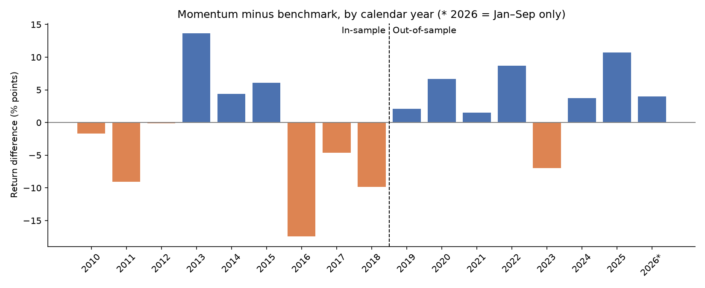

# Cross-Sectional Momentum Backtest on 59 ETFs

A backtest of a 12-1 month momentum strategy across 59 multi-asset ETFs (2009–2026), built in Python with transaction costs, strict controls against look-ahead bias, and an untouched out-of-sample test.

**Result in one line:** momentum lost to an equal-weight benchmark in-sample (2010–2018) but beat it out-of-sample (2019–Sep 2026), winning 7 of 8 years, so the effect is real in this sample but strongly regime-dependent.

---

## Key results

All figures are net of 10 bp transaction costs. Sharpe ratios assume a 0% risk-free rate.

| Metric | Momentum (in-sample) | Benchmark (in-sample) | Momentum (out-of-sample) | Benchmark (out-of-sample) |
|---|---|---|---|---|
| Annual return | 3.4% | 6.0% | **15.8%** | 11.8% |
| Annual volatility | 14.0% | 11.8% | 15.5% | 14.6% |
| Sharpe ratio | 0.25 | 0.51 | **1.02** | 0.81 |
| Max drawdown | −27.6% | −19.3% | **−15.5%** | −23.2% |
| Months beating benchmark | 46.8% | – | 49.5% | – |
| Annual turnover | 6.3 | – | 5.5 | – |

In-sample: Dec 2009 – Dec 2018 (109 months). Out-of-sample: Jan 2019 – Sep 2026 (93 months).



**Takeaways**

- **In-sample losses came from a few reversal years:** 2011, 2016 and 2018 cost 9–17 percentage points each. In a sharp reversal, momentum is holding the previous winners just as they turn.
- **The out-of-sample win was broad:** 7 of 8 years, and still +2.8 points a year on average without the best year.
- **It wins by size, not frequency:** out-of-sample it beat the benchmark in only 49.5% of months, yet won 7 of 8 years.
- **Costs were not the problem:** in-sample, momentum trailed the benchmark even at zero cost.

---

## Method

1. **Universe:** 59 US-listed ETFs across US equities, sectors, international equities, bonds, commodities and real estate. Selected by a fixed rule (broad, liquid, launched before Nov 2008) before looking at any returns.
2. **Data:** daily adjusted (total-return) closes from Yahoo Finance via `yfinance`, resampled to month-ends.
3. **Signal:** 12-1 momentum, the return from 12 months ago to 1 month ago. Skipping the latest month avoids the short-term reversal effect.
4. **Portfolio:** each month, rank all 59 ETFs and hold the top 20% (12 ETFs) at equal weight. Long-only, rebalanced monthly.
5. **Costs:** 10 bp per unit traded on both buys and sells, with a sensitivity test from 0 to 100 bp.
6. **Benchmark:** equal weight in all 59 ETFs. Same universe, no signal, so the difference isolates the signal itself.
7. **Testing:** all design choices were fixed on in-sample data, the out-of-sample period was run once, followed by a year-by-year walk-forward.

## How bias was controlled

- **Look-ahead bias:** weights chosen at the end of month *t* only earn month *t+1*'s return (one-month lag). Signals use only past prices (positive shifts only). Missing data could only be forward-filled, never back-filled.
- **Verified by hand:** SPY's December 2019 signal was recalculated manually and matched the code exactly.
- **Survivorship bias:** reduced by using ETFs rather than single stocks; residual bias remains because only ETFs still trading today are included.
- **Data snooping:** the design was frozen and documented before the out-of-sample analysis, and no parameters were changed afterwards.
- **Data checks:** no missing values; three daily moves over ±25% (USO in March and April 2020, SLV in January 2026) were checked against real market events and kept.

## Limitations

- A 0% risk-free rate overstates out-of-sample Sharpe ratios, since cash paid 4–5% from 2022.
- Each test period is only 8–9 years, so a few trending or reversing years drive the conclusion.
- Costs are a flat approximation, and intra-month weight drift is ignored (slightly understating turnover).
- Ranking raw returns across asset classes favours volatile assets such as oil, silver and emerging markets.

## Next steps

Subtract a real risk-free rate, test volatility-scaled or within-asset-class ranking, extend the history with index data, add a long-short version, and combine momentum with a carry signal. Any new choice would be decided on in-sample data only.

---

## Repository structure

```
momentum-backtest/
├── README.md
├── momentum_backtest.ipynb   # full analysis, with outputs
├── requirements.txt
├── charts/                   # equity curves, drawdowns, rolling Sharpe, cost sensitivity, yearly results
└── results/                  # in-sample, out-of-sample and walk-forward result tables (CSV)
```

## How to run

```bash
pip install -r requirements.txt
jupyter notebook momentum_backtest.ipynb
```

Then run all cells. Price data is downloaded from Yahoo Finance on the first run and is not included in this repository. Yahoo revises its data over time, so results from a fresh download may differ slightly.

---

*Tak Chun Chan · MEng Chemical Engineering, Imperial College London*
